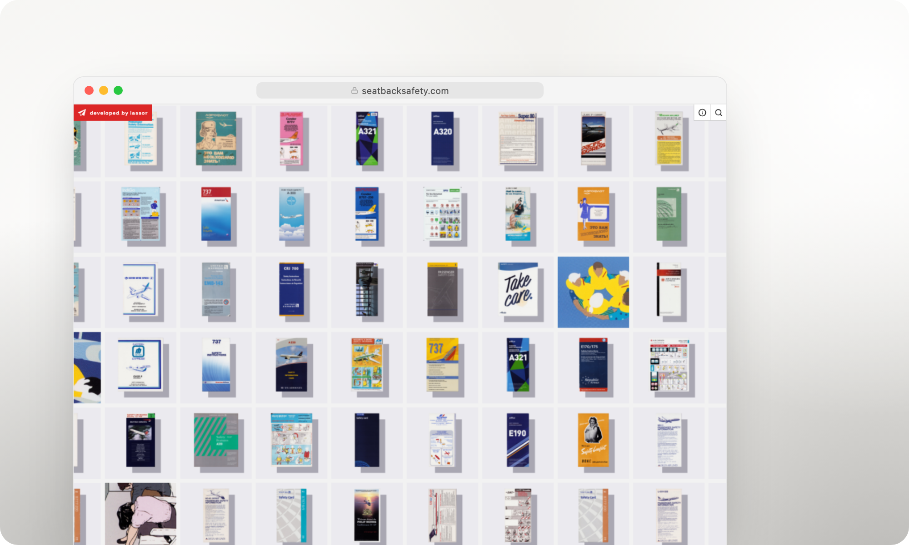

# Seatback Safety



An interactive archive of my collection of 300+ airline safety cards.

**Live:** [seatbacksafety.com](https://www.seatbacksafety.com)  
**Stack:** React, Vite, TypeScript, Tailwind, Konva, dnd-kit, Supabase, Vercel

---

## Fold editor

Admin interface for managing folded airline safety card structure.

### Features

- Drag and drop panels to reorder within a side
- Move panels between front and back sides
- Toggle crease fold direction (forward/backward)
- Automatic crease remapping when panels are reordered
- Local state management until save

### Setup

```bash
npm install
npm run dev
```

### Usage

The `FoldEditor` component accepts:
- `cardId`: Unique identifier for the safety card
- `initialPanels`: Array of panel objects with `id`, `side`, `panel_index`, and `thumbnail_url`
- `initialCreases`: Array of crease objects with `between_panel` and `fold_direction`
- `onSave`: Callback function that receives the updated panels and creases

### Database Schema

The component expects data matching your database schema:
- `card_panels`: panels with `side` (front/back) and `panel_index` (0-based)
- `card_creases`: creases with `between_panel` (panel_index) and `fold_direction` (forward/backward)


